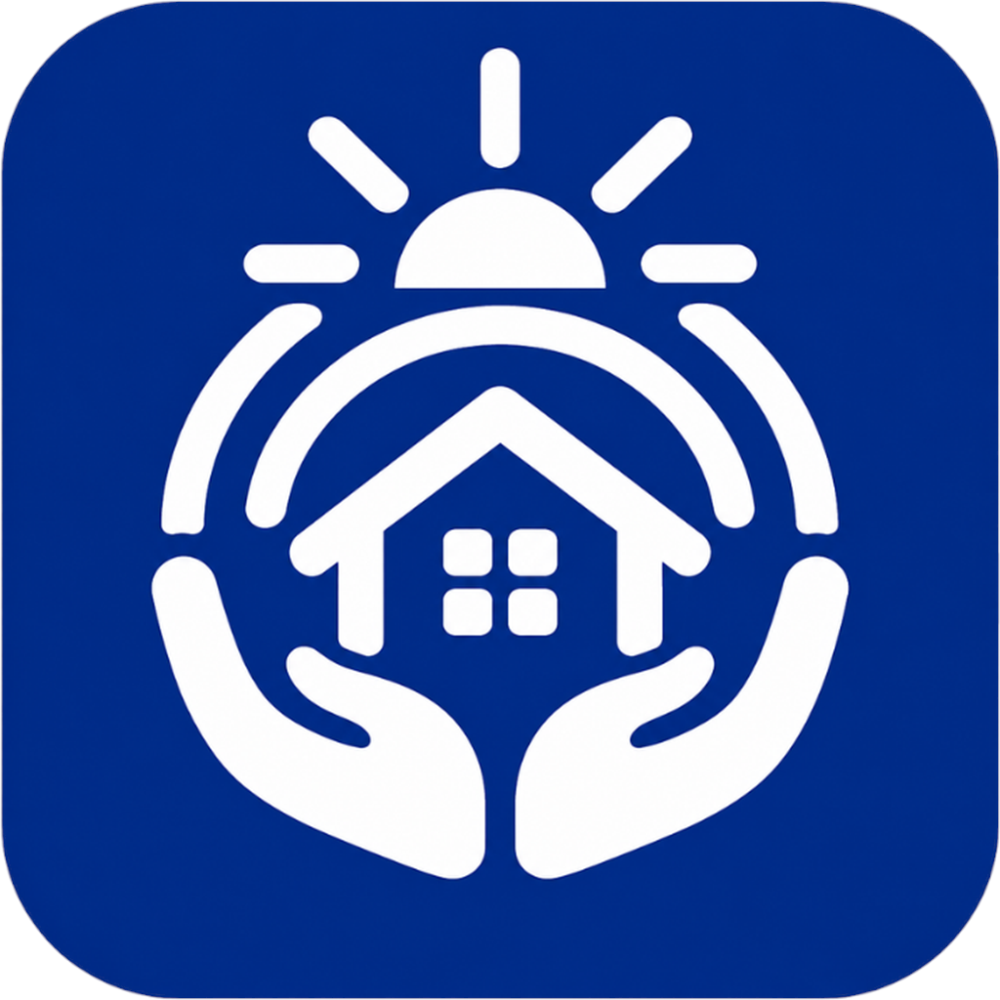
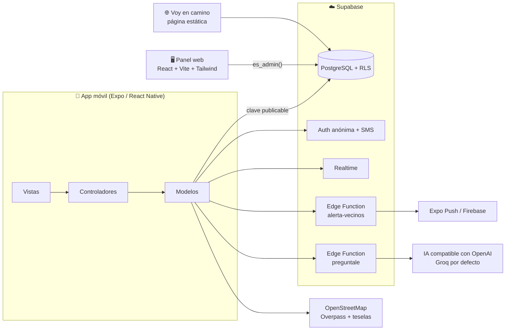

<div align="center">



# Kuna

**La app del barrio para adultos mayores de Ica, Perú.**
Pide ayuda en una emergencia, encuentra quién te ayuda cerca y mantente conectado con tus vecinos.


</div>

---

## Contenido

- [¿Qué es Kuna?](#qué-es-kuna)
- [Funciones](#funciones)
- [Cómo está armado](#cómo-está-armado)
- [Estructura del repositorio](#estructura-del-repositorio)
- [Puesta en marcha](#puesta-en-marcha)
- [Generar el APK](#generar-el-apk)
- [Pruebas](#pruebas)
- [Privacidad y seguridad](#privacidad-y-seguridad)
- [Documentación](#documentación)

---

## ¿Qué es Kuna?

Kuna es una app móvil pensada para **adultos mayores**: letra grande, botones de al menos 52 px, voz que lee la pantalla y micrófono en cada campo. Junta tres cosas en una sola app:

| | |
|---|---|
| 🆘 **Emergencia** | Un botón que llama sola a tus personas de confianza, al comité vecinal y a los servicios (106, 105, 116), y avisa a los vecinos cercanos. |
| 🏘️ **Barrio** | Negocios y oficios del barrio con «visto bueno» de los vecinos, ayuda entre vecinos y avisos de la comunidad. |
| 💊 **Día a día** | Alarma de pastillas, aviso si sales de casa, detección de caídas y un asistente al que le hablas («Pregúntale»). |

No hay servidor propio: todo vive en **Supabase** (PostgreSQL con seguridad por filas, Auth, Realtime y Edge Functions).

## Funciones

<details open>
<summary><b>🆘 Emergencia y seguridad</b></summary>

- **¿Estás bien?** Cuenta regresiva. Si no respondes, pide ayuda sola.
- **Cascada de llamadas.** Tus contactos → comité vecinal → posta más cercana → 106 SAMU → 105 → 116. Llama sola y pregunta «¿Contestó?».
- **Ubicación por SMS** con el enlace «Voy en camino», para que tu contacto avise que va.
- **Alerta vecinal.** Los vecinos a unos 500 m reciben «Un vecino necesita ayuda a X m». Solo quien toca «Voy a ayudar», y cumple las protecciones, ve tu nombre y tu dirección.
- **Radar de ayuda.** Postas, hospitales, bomberos y comisarías a 1 o 2 km. Los datos salen de OpenStreetMap y quedan guardados para usarlos sin internet.
- **Detección de caídas.** Usa el acelerómetro y abre «¿Estás bien?» con «Parece que te caíste».
- **Aviso si sales de casa.** Funciona con la ubicación en segundo plano.

</details>

<details>
<summary><b>🏘️ Barrio y comunidad</b></summary>

- **Servicios.** Bodegas, panaderías, farmacias, menú del día y oficios. Muestra los minutos a pie y si está abierto, y permite dar visto bueno o reportar.
- **Sube tu negocio**, con foto, horario y precio.
- **Ayuda entre vecinos.** Pedidos por categoría, con vencimiento.
- **Comunidad.** Kermés, misa, donaciones, talleres y más.

</details>

<details>
<summary><b>💊 Cuidado diario y accesibilidad</b></summary>

- **Pastillas.** Alarma con sonido y vibración. Se puede decir por voz: «la pastilla de la presión a las 8».
- **Pregúntale.** Asistente por voz. La IA solo elige qué acción hacer; nunca inventa respuestas.
- **Modo sencillo o completo**, tamaño de letra, tema oscuro, voz que lee la pantalla y micrófono en cada campo.
- **Mapa que funciona con y sin internet.** Usa una copia del mapa guardada en el teléfono.

</details>

<details>
<summary><b>🛠️ Panel del administrador</b></summary>

Pestañas: Resumen del día (con tiempo de uso), Servicios ocultos, Grupos de apoyo, Emergencias activas, Emergencias cerradas, Comunidad oculta y Bloqueos.

</details>

## Cómo está armado



- **App en MVC.** Las pantallas (`app/` y `src/vistas/`) nunca hablan con Supabase: lo hacen los controladores (`src/controladores/`) a través de los repositorios (`src/modelos/`).
- **Sin internet, la emergencia funciona igual.** Las llamadas y los SMS salen del chip del teléfono. La nube solo suma: el contador de quién va, la alerta vecinal y el enlace «Voy en camino».

## Estructura del repositorio

```text
kuna/
├── app-movil/                 App Expo (React Native + TypeScript)
│   ├── app/                   Pantallas (expo-router): alta, principal, sos, servicios,
│   │                          comunidad, pastillas, ayuda-vecinos, perfil, preguntale…
│   ├── src/
│   │   ├── controladores/     Lógica de cada pantalla (hooks)
│   │   ├── modelos/           Repositorios de Supabase, reglas puras y datos locales
│   │   └── vistas/            Componentes accesibles y tema (tokens.ts)
│   ├── assets/                Logo, ilustraciones, sonidos y datos de emergencia
│   ├── android/               Proyecto nativo de Android
│   ├── scripts/               correr-android.ps1 (compilar, instalar y generar el APK)
│   ├── generar-apk.bat        Doble clic: deja el APK en el Escritorio
│   └── docs/                  Decisiones de frontend y correcciones por fases
├── panel-web/                 Panel del administrador (React 19 + Vite + Tailwind)
├── backend/
│   ├── database/              Scripts SQL 01 a 12 (se corren en orden)
│   ├── supabase/functions/    Edge Functions: alerta-vecinos y preguntale (Deno)
│   ├── web/voy-en-camino/     Página «Voy en camino» para los contactos
│   ├── pruebas/               Pruebas de RLS, módulo 2, admin y uso
│   └── docs/                  Especificación, contratos y configuración
└── docs/propuestas/           Borradores y propuestas
```

## Puesta en marcha

### 1. Base de datos (Supabase)

Corre cada script en el **SQL Editor** de Supabase, en este orden. Se pueden correr dos veces sin error.

| # | Script | Qué hace |
|---|---|---|
| 1 | `01_tablas.sql` | Tablas, claves, restricciones y listas de categorías |
| 2 | `02_funciones.sql` | Funciones, triggers, RPC y vistas del módulo 1 |
| 3 | `03_politicas.sql` | Seguridad por filas (RLS) |
| 4 | `04_datos_prueba.sql` | Zonas de Ica y grupos de apoyo ficticios |
| 5 | `05_verificaciones.sql` | Comprueba RLS y que `admins` no tenga políticas para la app |
| 6 | `06_mantenimiento.sql` | Mantenimiento manual: no hace falta para montar el proyecto |
| 7 | `07_mockup_v4.sql` | Emergencias, comunidad, alerta vecinal y `yo_ayudo` |
| 8 | `08_ajustes_backend.sql` | Reportes de comunidad, tope de emergencias y marca de aviso push |
| 9 | `09_datos_demo.sql` | Datos de demo: negocios, publicaciones y un pedido (lo ejecuta Karla) |
| 10 | `10_uso_y_comunidad.sql` | Tiempo de uso por zona y lugar del evento en publicaciones |
| 11 | `11_admin_perfiles.sql` | El admin puede leer `perfiles`; un vecino sigue leyendo solo el suyo (lo ejecuta Karla, después del respaldo) |
| 12 | `12_admin_grupos.sql` | El admin puede crear, editar y borrar grupos de apoyo (lo ejecuta Karla) |

Después configura **Auth anónima**, el **SMS con Twilio**, **Firebase** para el push y los **secretos de las Edge Functions**. Todo eso está explicado paso a paso en [`backend/docs/configuracion.md`](backend/docs/configuracion.md).

### 2. App móvil

```bash
cd app-movil
npm install
cp .env.example .env    # pon EXPO_PUBLIC_SUPABASE_URL y EXPO_PUBLIC_SUPABASE_ANON_KEY
```

La voz, la ubicación y las llamadas necesitan un **development build**; Expo Go no alcanza. En Windows, con el teléfono conectado por USB o un emulador abierto:

```bash
powershell -ExecutionPolicy Bypass -File .\scripts\correr-android.ps1
```

El script revisa Node 22.13 o más nuevo, Java 17 y el SDK de Android. Luego compila, instala y abre la app.

### 3. Panel web

```bash
cd panel-web
# crea .env con VITE_SUPABASE_URL y VITE_SUPABASE_ANON_KEY (la clave publicable)
npm install
npm run dev
```

El admin entra con correo y contraseña de Supabase Auth. La base confirma el permiso con `es_admin()`, y el alta de admins sigue siendo a mano.

## Generar el APK

Desde `app-movil`, con doble clic en **`generar-apk.bat`** o en la terminal:

```bash
.\generar-apk.bat
```

Al terminar, el APK queda en tu **Escritorio** como `Kuna-AAAA-MM-DD.apk`, listo para enviarlo por WhatsApp o Drive. Sirve para casi todos los Android: arm64-v8a y armeabi-v7a.

> Si falta `app-movil/.env`, el script ofrece crearlo con la URL y la clave publicable de `panel-web/.env`. La primera compilación tarda de 10 a 30 minutos. Si algo falla, el detalle queda en `app-movil/node_modules/.vecinos-tmp/log-android.txt`.

## Pruebas

```bash
cd backend/pruebas
cp ../.env.example ../.env   # SUPABASE_URL y SUPABASE_ANON_KEY
npm test
```

Necesitan las cuentas anónimas activas en Supabase. Cubren los casos 1 a 20 de RLS, además del módulo 2, el admin y el uso de la comunidad. Las Edge Functions tienen sus propias pruebas en Deno (`*_test.ts`).

En la app:

```bash
cd app-movil
npx tsc --noEmit
```

## Privacidad y seguridad

- 🔑 **Solo la clave publicable** va en la app y en el panel. La clave `service_role`, la de la IA y la del push viven como secretos de Supabase y nunca se suben al repositorio.
- 📵 **Tus contactos, tu ficha de salud y tu consentimiento se quedan en el teléfono.** Nunca suben a Supabase.
- 🛡️ **Datos de emergencia temporales.** Tu nombre, tu dirección y tu ubicación exacta se borran al cerrar la emergencia o a las 2 horas. El registro de quién los vio se guarda 7 días, para revisar abusos (Ley 29733).
- 📍 **La alerta vecinal no da tu dirección.** Solo la ve el vecino que confirma «Voy a ayudar», tiene el celular verificado, vive a 500 m o menos y está a 1 km o menos.
- 🗺️ **OpenStreetMap.** La app se identifica con su propio User-Agent y guarda una copia local de los mapas y de los lugares, para no pedirlos de nuevo.

## Documentación

| Documento | De qué trata |
|---|---|
| [`backend/docs/especificacion.md`](backend/docs/especificacion.md) | Especificación funcional |
| [`backend/docs/contrato_app_base.md`](backend/docs/contrato_app_base.md) | Contrato entre la app y la base (módulo 1) |
| [`backend/docs/contrato_modulo2.md`](backend/docs/contrato_modulo2.md) | Contrato de emergencias, alerta vecinal y comunidad |
| [`backend/docs/configuracion.md`](backend/docs/configuracion.md) | Supabase, Twilio, Firebase y Expo, paso a paso |
| [`backend/docs/spec_alerta_vecinos.md`](backend/docs/spec_alerta_vecinos.md) | Edge Function de alerta vecinal |
| [`backend/docs/spec_preguntale.md`](backend/docs/spec_preguntale.md) | Edge Function del asistente por voz |
| [`backend/docs/spec_voy_en_camino.md`](backend/docs/spec_voy_en_camino.md) | Página «Voy en camino» |
| [`backend/docs/USO_DE_IA.md`](backend/docs/USO_DE_IA.md) | Cómo se usó la IA en el proyecto |
| [`app-movil/docs/DECISIONES_FRONTEND.md`](app-movil/docs/DECISIONES_FRONTEND.md) | Decisiones de diseño de la app |
| [`app-movil/docs/FASES_CORRECCIONES.md`](app-movil/docs/FASES_CORRECCIONES.md) | Correcciones por fases (mapa sin internet, voz, caídas, alerta) |

---

<div align="center">

Hecho con cariño para el barrio · Hackatón UTP 2026 · Ica, Perú 🇵🇪

</div>
